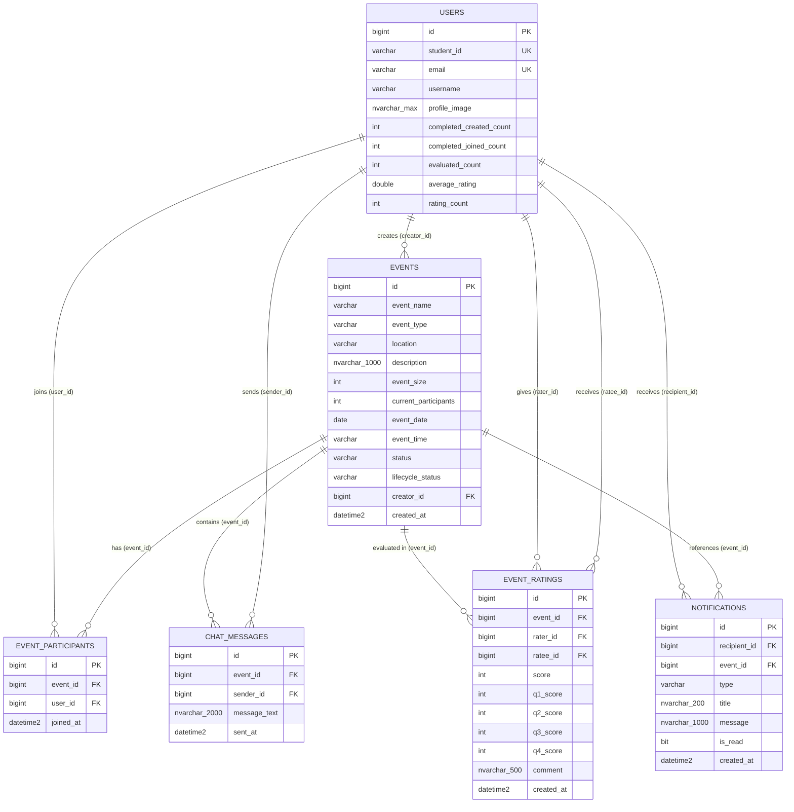

# TU Meet (CS261 Project Group 08)

TU Meet คือเว็บแอปพลิเคชันสำหรับนักศึกษามหาวิทยาลัยธรรมศาสตร์ในการค้นหาเพื่อนร่วมทำกิจกรรมต่าง ๆ ภายในมหาวิทยาลัย ออกแบบขึ้นเพื่อให้นักศึกษาสามารถสร้างกิจกรรม, ค้นหาและคัดกรองกิจกรรมที่สนใจ, กดเข้าร่วมหรือยกเลิกกิจกรรม, พูดคุยกับสมาชิกผ่านแชทกลุ่มแบบเรียลไทม์, ประเมินคะแนนหลังจบกิจกรรม, สะสมแต้มเพื่อรับยศ (Badges), รับการแจ้งเตือนรายบุคคล, และจัดการโปรไฟล์ส่วนตัวได้อย่างสะดวก รวดเร็ว และปลอดภัย

---

## 🏗️ 1. สถาปัตยกรรมและหลักการทำงานของระบบ (System Architecture)

ระบบ TU Meet พัฒนาด้วยรูปแบบ **Decoupled 3-Tier Architecture** (แยกส่วน Client-Side, Server-Side และ Database ออกจากกันอย่างชัดเจนภายใต้ Docker Network) เพื่อความยืดหยุ่นในการพัฒนาและรองรับการขยายตัวในอนาคต

```
+------------------------------------------------------------------+
|             Client-Side (Frontend - tumeet-frontend)             |
|      Nginx (Port 80) + HTML5 / CSS3 / Vanilla JS (ES6+)          |
+------------------------------------------------------------------+
                                 |
      Reverse Proxy: /api/* (REST JSON) & /ws/* (WebSocket)
                                 |
+------------------------------------------------------------------+
|             Server-Side (Backend - tumeet-backend)               |
|  Tomcat 10.1 / Spring Boot 4.1.x / Java 21 / JPA / WebSocket     |
+------------------------------------------------------------------+
                                 |
                          JDBC Connection
                                 |
+------------------------------------------------------------------+
|                    Database (tumeet-db)                          |
|              Microsoft SQL Server 2022 (Port 1433)               |
+------------------------------------------------------------------+
```

### หลักการทำงานของฟังก์ชันหลัก:

1. **ระบบยืนยันตัวตน (Authentication Flow):**
   * **TU REST API v1:** เชื่อมต่อกับระบบยืนยันตัวตนของมหาวิทยาลัยธรรมศาสตร์ (`POST https://restapi.tu.ac.th/api/v1/auth/Ad/verify`) โดยตรวจสอบ `UserName` (รหัสนักศึกษา) และ `PassWord` (เลขบัตรประชาชน) และนำข้อมูลนักศึกษา (ชื่อ-นามสกุล, อีเมล, คณะ, สาขา) มาบันทึกหรืออัปเดตลงฐานข้อมูลอัตโนมัติ
   * **In-Memory Mock Login:** สำหรับการพัฒนาและทดสอบแบบออฟไลน์ ระบบมีบัญชีจำลอง (`6800000000` - `6800000009`) ที่ตรวจสอบในหน่วยความจำโดยไม่ต้องเชื่อมต่อ TU API ภายนอก

2. **ระบบฟีดกิจกรรมและการดูรายละเอียด (Event Feed, Filtering & Event Details):**
   * ดึงข้อมูลกิจกรรมจากฐานข้อมูล SQL Server ผ่าน REST API (`GET /api/events`) และดึงรายละเอียดรายกิจกรรมผ่าน `GET /api/events/{eventId}`
   * **Event Description & Details (US-10):** รองรับการแนบรายละเอียดเพิ่มเติมของกิจกรรม (`description` สูงสุด 1,000 ตัวอักษร) พร้อม Popup ดูรายละเอียดและรายชื่อสมาชิก รวมถึงเปิดให้ผู้สร้างแก้ไขคำอธิบายกิจกรรมได้ (`PUT /api/events/{eventId}/description`)
   * **Smart Event Sorting & Category Filter:** คัดแยกกิจกรรมที่ยังไม่หมดเวลา (`UPCOMING`) ไว้ด้านบนสุดตามวัน/เวลาจัดกิจกรรม ส่วนกิจกรรมที่หมดเวลาหรือยกเลิกแล้วจะถูกจัดกลุ่มลงด้านล่าง พร้อมกรองตามหมวดหมู่ (วิชาการ, กีฬา, บันเทิง, ไลฟ์สไตล์)

3. **ระบบเข้าร่วม ยกเลิก และวงจรชีวิตกิจกรรม (Join, Leave & Event Lifecycle):**
   * **Join / Leave:** ผู้ใช้กดเข้าร่วม (`POST /api/events/{id}/join`) หรือยกเลิกการเข้าร่วม (`POST /api/events/{id}/leave`) โดยตรวจสอบความจุ (`OPEN`, `FULL`, `CLOSED`) และป้องกันการเข้าร่วมซ้ำหรือเข้าร่วมกิจกรรมตัวเอง
   * **Event Cancellation:** เมื่อผู้สร้างกดยกเลิกกิจกรรม (`POST /api/events/{id}/cancel` หรือ `/leave` โดยผู้สร้าง) ระบบจะเปลี่ยน `lifecycle_status` เป็น `CANCELLED` และ `status` เป็น `CLOSED` โดยไม่ลบข้อมูลกิจกรรมทิ้ง
   * **Auto-Completion & Points (US-9):** ระบบมี `@Scheduled` ตรวจสอบทุก 1 นาที และซิงค์อัตโนมัติเมื่อเรียกข้อมูล เพื่อเปลี่ยนกิจกรรมที่เลยวัน/เวลาจัดเป็น `COMPLETED` และแจกแต้มกิจกรรมสำเร็จ `+1` (`completed_created_count` สำหรับผู้สร้าง / `completed_joined_count` สำหรับผู้เข้าร่วม) เฉพาะกิจกรรมที่มีสมาชิกรวมตั้งแต่ **2 คนขึ้นไป**

4. **ระบบจัดการโปรไฟล์ รูปโปรไฟล์ และระบบยศ (Profile, Avatar & Badges):**
   * แก้ไขชื่อผู้ใช้ (`PUT /api/user/update-username`) และอัปโหลด/บันทึกรูปโปรไฟล์แบบ Base64 Data URL (`PUT /api/user/update-profile-image`) ลงฐานข้อมูลจริง (`users.profile_image`)
   * **ระบบคำนวณยศ (Badges):** คำนวณใน `User.getBadge()` จากค่าสูงสุดระหว่างยอดรวมกิจกรรมที่ทำสำเร็จ (`completedCreatedCount + completedJoinedCount`) และแต้มจากการประเมินกิจกรรม (`evaluatedCount` ที่เพิ่มขึ้น `+1` เมื่อประเมินกิจกรรมหรือส่งผ่าน `POST /api/events/evaluate`):
     * `0 ครั้ง` → **No Badge**
     * `1 - 4 ครั้ง` → **Newly Bee**
     * `5 - 9 ครั้ง` → **Baby Bloom**
     * `10 - 19 ครั้ง` → **Happy Blossom**
     * `20 ครั้งขึ้นไป` → **Super Bouquet**

5. **ระบบแชทกลุ่มแบบเรียลไทม์ (Event Group Chat - US-7):**
   * **1 กิจกรรม = 1 ห้องแชท** ใช้การสื่อสารแบบเรียลไทม์ผ่าน WebSocket (`/ws/chat`) ควบคู่กับ REST API (`/api/chat/*`)
   * เฉพาะผู้สร้างและผู้เข้าร่วมของกิจกรรมที่ไม่ได้ถูกยกเลิกเท่านั้นจึงจะมีสิทธิ์เข้าดูห้องแชทและส่งข้อความ โดยทุกข้อความจะถูกบันทึกลงตาราง `chat_messages` (สูงสุด 2,000 ตัวอักษร)

6. **ระบบประเมินผลและให้คะแนน (Event Review & Peer-to-Peer Rating - US-8):**
   * เปิดให้ประเมินได้เฉพาะกิจกรรมที่มีสถานะ `COMPLETED` เท่านั้น
   * รองรับทั้งการประเมินกิจกรรมผ่านแบบฟอร์ม 4 หัวข้อ + ความคิดเห็น (`Review.html`), การประเมินเพื่อนร่วมกิจกรรมรายบุคคล (1-5 ดาว), และการส่งแบบประเมินเพื่อสะสมแต้ม Badge (`POST /api/events/evaluate` เพิ่มค่า `evaluatedCount` +1)
   * ป้องกันการประเมินซ้ำด้วย `UniqueConstraint(event_id, rater_id, ratee_id)` ในตาราง `event_ratings` พร้อมคำนวณ `average_rating` และ `rating_count` เก็บลงตาราง `users` ทันที

7. **ระบบแจ้งเตือนรายบุคคล (Individual Notifications - US-11):**
   * สร้างรายการแจ้งเตือนแยกตาม `recipient_id` ในตาราง `notifications` เพื่อให้สถานะการอ่าน (`is_read`) เป็นอิสระต่อกันในแต่ละคน
   * รองรับเหตุการณ์: `CREATE_SUCCESS`, `JOIN_SUCCESS`, `USER_JOINED`, `LEAVE_SUCCESS`, `USER_LEFT`, `CANCEL_SUCCESS`, `EVENT_CANCELLED`, `EVENT_REMINDER` (แจ้งเตือนล่วงหน้า 30 นาทีก่อนเริ่มกิจกรรม), `EVENT_COMPLETED`, และ `BADGE_UPGRADED` (เมื่อเลื่อนระดับยศ)

---

## 🗄️ 2. โครงสร้างฐานข้อมูล (Database Schema)



---

## 📋 3. รายการ User Stories (US) และสถานะการดำเนินงาน (Release v1.0.0)

### 🏃‍♂️ Sprint 1 Backlog
| รหัส US | รายละเอียด User Story | สถานะ |
| :---: | :--- | :---: |
| **US1** | นศ.มธ. สร้างห้องกิจกรรม | **เสร็จสมบูรณ์ (Completed)** |
| **US2** | นศ.มธ. เข้าร่วมห้องกิจกรรม | **เสร็จสมบูรณ์ (Completed)** |
| **US3** | นศ.มธ. ต้องการยกเลิกเข้าร่วมห้องกิจกรรม | **เสร็จสมบูรณ์ (Completed)** |
| **US4** | นศ.มธ. LOGIN by TU API (รองรับทั้ง TU API จริง และ Mock Accounts) | **เสร็จสมบูรณ์ (Completed)** |
| **US5** | นศ.มธ. ยกเลิกการสร้างห้องกิจกรรม | **เสร็จสมบูรณ์ (Completed)** |

### 🚀 Sprint 2 Backlog
| รหัส US | รายละเอียด User Story | สถานะ |
| :---: | :--- | :---: |
| **US6** | นศ.มธ. แก้ไขข้อมูลส่วนตัว รูปโปรไฟล์ (Avatar) และดูประวัติกิจกรรม | **เสร็จสมบูรณ์ (Completed)** |
| **US7** | นศ.มธ. ใช้ระบบห้องแชทกลุ่มแบบเรียลไทม์ (WebSocket) เพื่อพูดคุยกับเพื่อนร่วมกิจกรรม | **เสร็จสมบูรณ์ (Completed)** |
| **US8** | นศ.มธ. ประเมินคะแนนกิจกรรมและผู้เข้าร่วมกิจกรรม (Rating & Review) | **เสร็จสมบูรณ์ (Completed)** |
| **US9** | นศ.มธ. มีระบบสถานะวงจรชีวิตกิจกรรม การนับแต้มกิจกรรมสำเร็จ (+1) และ Badges ที่หน้าโปรไฟล์ | **เสร็จสมบูรณ์ (Completed)** |
| **US10** | นศ.มธ. ดูรายละเอียดเพิ่มเติมของกิจกรรม (Description) และแก้ไขคำอธิบายกิจกรรม | **เสร็จสมบูรณ์ (Completed)** |
| **US11** | นศ.มธ. รับการแจ้งเตือนรายบุคคล (เข้าร่วม/ยกเลิก/ใกล้เริ่มกิจกรรม/จบกิจกรรม/อัปเกรดยศ) | **เสร็จสมบูรณ์ (Completed)** |

---

## 🔌 4. สรุป API และ WebSocket Endpoints

| หมวดหมู่ | Method & Endpoint | คำอธิบาย |
| :--- | :--- | :--- |
| **Auth** | `POST /api/login` | ยืนยันตัวตนผ่าน TU REST API v1 หรือ Mock Account |
| **User** | `GET /api/user/{studentId}` | ดึงข้อมูลโปรไฟล์ ยอดกิจกรรมสำเร็จ ยศ และคะแนนเฉลี่ย |
| **User** | `PUT /api/user/update-username` | อัปเดตชื่อผู้ใช้ (Username) |
| **User** | `PUT /api/user/update-profile-image` | อัปเดตรูปโปรไฟล์แบบ Base64 Data URL (`data:image/...`) |
| **Events** | `GET /api/events` | ดึงรายการกิจกรรมทั้งหมด (รองรับ `?creatorStudentId=` และ `?participantStudentId=`) |
| **Events** | `GET /api/events/{eventId}` | ดึงรายละเอียดกิจกรรมรายตัว |
| **Events** | `POST /api/events` | สร้างกิจกรรมใหม่ (ตั้งเวลาล่วงหน้าได้ไม่เกิน 7 วัน) |
| **Events** | `PUT /api/events/{eventId}/description` | อัปเดตคำอธิบายกิจกรรม (เฉพาะผู้สร้างกิจกรรม) |
| **Events** | `POST /api/events/{eventId}/join` | เข้าร่วมกิจกรรม (รองรับ `/api/events/join` ด้วย) |
| **Events** | `POST /api/events/{eventId}/leave` / `cancel` | ยกเลิกการเข้าร่วม หรือยกเลิกกิจกรรมโดยผู้สร้าง |
| **Events** | `GET /api/events/{eventId}/participants` | ดึงรายชื่อผู้เข้าร่วมกิจกรรม |
| **Events** | `POST /api/events/evaluate` | ส่งแบบประเมินกิจกรรมเพื่อรับแต้มสะสม Badge (`+1`) |
| **Chat** | `GET /api/chat/rooms?studentId={id}` | ดึงรายการห้องแชทและข้อความล่าสุดของผู้ใช้ |
| **Chat** | `GET /api/chat/events/{eventId}/messages?studentId={id}` | ดึงประวัติแชทย้อนหลังของกิจกรรม |
| **Chat** | `POST /api/chat/events/{eventId}/messages` | ส่งข้อความแชทผ่าน REST API พร้อม Broadcast |
| **Chat (WS)** | `WS /ws/chat` | เชื่อมต่อ WebSocket สำหรับรับส่งข้อความแชทแบบเรียลไทม์ |
| **Ratings** | `GET /api/events/{eventId}/ratings/members?raterStudentId={id}` | ดึงรายชื่อสมาชิกในกิจกรรมและสถานะการประเมิน |
| **Ratings** | `GET /api/events/{eventId}/ratings/status?studentId={id}` | ตรวจสอบสถานะการประเมินกิจกรรมของผู้ใช้ |
| **Ratings** | `GET /api/events/ratings/reviewed?studentId={id}` | ดึงรายการ `eventId` ทั้งหมดที่ผู้ใช้ประเมินแล้ว |
| **Ratings** | `POST /api/events/{eventId}/ratings` | ส่งคะแนนประเมิน (รองรับทั้งแบบรายบุคคล 1-5 ดาว และแบบฟอร์ม 4 หัวข้อ) |
| **Notifications** | `GET /api/notifications?studentId={id}` | ดึงแจ้งเตือนรายบุคคลพร้อม `unreadCount` |
| **Notifications** | `PUT /api/notifications/{notificationId}/read` | ทำเครื่องหมายว่าอ่านแจ้งเตือนรายการนั้นแล้ว |
| **Notifications** | `PUT /api/notifications/read-all?studentId={id}` | ทำเครื่องหมายว่าอ่านแจ้งเตือนทั้งหมดของผู้ใช้แล้ว |

---

## 🛠️ 5. วิธีการเริ่มใช้งานระบบอย่างเป็นขั้นตอน (Step-by-Step Setup Guide)

### สิ่งที่ต้องติดตั้งล่วงหน้า (Prerequisites)
1. **Git**
2. **Docker Desktop** (สำหรับรันระบบทั้งหมด 3 ส่วน: Frontend Nginx, Backend Tomcat/Spring Boot, และ Database MS SQL Server 2022)
3. **Web Browser** (เช่น Google Chrome, Microsoft Edge)
4. *(ทางเลือกสำหรับนักพัฒนา)* **JDK 21** กรณีต้องการรัน Backend หรือ Unit Test บนเครื่องโดยตรง

---

### ขั้นตอนที่ 1: การ Clone โปรเจกต์
เปิด Terminal หรือ PowerShell แล้วรันคำสั่ง:
```bash
git clone https://github.com/Pithayakorn-Tam/CS261_Project_Group08.git
cd CS261_Project_Group08
```

---

### ขั้นตอนที่ 2: การตั้งค่า TU Application-Key ด้วยไฟล์ `.env` (กรณีต้องการใช้ TU API จริง)
หากต้องการเชื่อมต่อระบบล็อกอินกับ TU REST API จริงของมหาวิทยาลัยธรรมศาสตร์ (หากใช้ Mock Account สามารถข้ามขั้นตอนนี้ได้):

1. สร้างไฟล์ชื่อ `.env` ไว้ที่โฟลเดอร์รากของโปรเจกต์ (`CS261_Project_Group08/.env`)
2. เพิ่มคีย์ลงในไฟล์ `.env`:
   ```env
   TU_API_KEY=your_actual_application_key_here
   ```

> 💡 **คำอธิบายเพิ่มเติม:**  
> * **ใส่แค่ในไฟล์ `.env` เพียงที่เดียวก็เพียงพอแล้วครับ** ไม่จำเป็นต้องใส่ใน `backend/src/main/resources/application.properties` (ปล่อยเป็น `tu.api.key=` ว่างไว้ได้เลย)  
> * เนื่องจาก `application.properties` มีคำสั่ง `spring.config.import=optional:file:./.env[.properties]...`, `AuthService.java` ใช้ `@Value("${tu.api.key:${TU_API_KEY:}}")` และ `docker-compose.yml` ส่งค่าจาก `.env` เข้าสู่คอนเทนเนอร์ให้อัตโนมัติ  
> * ⚠️ **ความปลอดภัย:** ไฟล์ `.env` ถูกป้องกันไว้ใน `.gitignore` แล้ว จึงช่วยป้องกันไม่ให้ Token จริงหลุดขึ้น GitHub

---

### ขั้นตอนที่ 3: เริ่มต้นรันระบบทั้งหมดด้วย Docker Compose
ที่โฟลเดอร์รากของโปรเจกต์ (`CS261_Project_Group08`) เปิด Docker Desktop แล้วรันคำสั่ง:
```bash
docker compose up -d --build
```
> ระบบจะสร้างและรัน Container ทั้ง 3 ส่วนภายใต้เครือข่าย `tumeet-network` อัตโนมัติ:
> 1. **`tumeet-db`** (พอร์ต `1433`): ฐานข้อมูล MS SQL Server 2022 พร้อมสร้างฐานข้อมูล `tumeetdb` อัตโนมัติ
> 2. **`tumeet-backend`** (พอร์ต `8080`): คอมไพล์ด้วย Maven Multi-stage build และรันบน Tomcat 10.1 (JDK 21) พร้อมสร้างข้อมูลตั้งต้น (Data Initializer)
> 3. **`tumeet-frontend`** (พอร์ต `80`): เว็บเซิร์ฟเวอร์ Nginx สำหรับเสิร์ฟหน้าเว็บและทำ Reverse Proxy (`/api/*` และ `/ws/*` → `tumeet-backend:8080`)

ตรวจสอบสถานะ Container (รอจนขึ้นสถานะ `healthy`):
```bash
docker compose ps
```

ดู Log การทำงานของ Backend:
```bash
docker compose logs -f tumeet-backend
```

หยุดการทำงานของระบบทั้งหมด:
```bash
docker compose down
```

---

### ขั้นตอนที่ 4: เปิดใช้งานระบบผ่าน Web Browser
เมื่อ Container ทั้ง 3 ส่วนทำงานพร้อมแล้ว (`healthy`) สามารถเข้าใช้งานได้ทันทีที่:
* **หน้าเว็บหลัก (ผ่าน Nginx พอร์ต 80):** `http://localhost` (จะพาไปยัง `http://localhost/html/Login.html` อัตโนมัติ)
* **ตรวจสอบ Backend API โดยตรง:** `http://localhost:8080/api/events` หรือผ่าน Nginx Proxy ที่ `http://localhost/api/events`

---

### 💡 ทางเลือกเพิ่มเติม: การรันแยกส่วนสำหรับนักพัฒนา (Local Development) และ Unit Tests
หากต้องการรันเฉพาะฐานข้อมูลใน Docker แล้วรัน Backend / Frontend บนเครื่องโดยตรง:
1. รันเฉพาะฐานข้อมูล:
   ```bash
   docker compose up -d tumeet-db
   ```
2. รัน Backend ด้วย Maven Wrapper:
   * **Windows:**
     ```powershell
     cd backend
     .\mvnw.cmd spring-boot:run
     ```
   * **macOS / Linux:**
     ```bash
     cd backend
     ./mvnw spring-boot:run
     ```
3. รัน Unit Tests ทั้งหมดของ Backend:
   * **Windows:** `cd backend` แล้วรัน `.\mvnw.cmd test`
   * **macOS / Linux:** `cd backend` แล้วรัน `./mvnw test`
4. เปิดไฟล์ `frontend/html/Login.html` ผ่านส่วนขยาย **Live Server** (พอร์ต `5500` หรือ `5501`) โดยระบบใน `api.js` และ `Chat.js` จะชี้ API/WebSocket ไปยัง `http://localhost:8080` ให้อัตโนมัติ

---

### 🔑 ข้อมูลบัญชีผู้ใช้จำลองสำหรับทดสอบ (In-Memory Mock Accounts)
ในกรณีที่ไม่ได้เชื่อมต่อ TU API จริง สามารถใช้บัญชีจำลองที่เตรียมไว้ในระบบเพื่อทดสอบได้ทันที:

* **รหัสนักศึกษา (Username):** `6800000000` ถึง `6800000009` (เลือกใช้รหัสใดก็ได้)
* **รหัสผ่าน / เลขบัตรประชาชน (Password):** `1111111111111` (เลข 1 จำนวน 13 หลัก)

> 💡 **หมายเหตุ:** ข้อมูลบัญชีจำลองเหล่านี้ถูกตรวจสอบในระดับหน่วยความจำ (In-Memory) ไม่ถูกส่งออกไปยังภายนอก และมีข้อมูลนักศึกษาจำลอง กิจกรรมจำลอง (ทั้งที่จบแล้วและกำลังจะมาถึง) รวมถึงการแจ้งเตือนตั้งต้นถูกบันทึกไว้ในฐานข้อมูลล่วงหน้าโดย `DataInitializer`

---

### 🌐 การใช้งาน ngrok สำหรับ Tunneling และทดสอบจากภายนอก
ในกรณีที่ต้องการแชร์เว็บให้ทดสอบจากอุปกรณ์อื่นภายนอกเครือข่าย หรือทดสอบบริการภายนอกที่ต้องการ Public URL (เช่น Webhook / Callback):
1. ติดตั้ง [ngrok](https://ngrok.com/) และตั้งค่า Authtoken (`ngrok config add-authtoken <your_token>`)
2. รันคำสั่ง Forward พอร์ตที่ต้องการ:
   * **แชร์เว็บทั้งระบบ (ผ่าน Frontend Nginx พอร์ต 80 แนะนำ):**
     ```bash
     ngrok http 80
     ```
   * **หรือ Forward เฉพาะ Backend API (พอร์ต 8080):**
     ```bash
     ngrok http 8080
     ```
3. นำ Public URL ที่ได้จาก ngrok (เช่น `https://xxxx.ngrok-free.app`) ไปใช้งานหรือส่งต่อเพื่อทดสอบได้ทันที

---

## 👥 6. สมาชิกกลุ่ม CS261 Group 08

| ลำดับ | รหัสนักศึกษา | ชื่อ - นามสกุล | GitHub Account | หน้าที่รับผิดชอบ (Role) |
| :---: | :---: | :--- | :---: | :--- |
| 1 | `6809617258` | นายพิชญ์ทยากร ศิริสุนทรกมล | [@Pithayakorn-Tam](https://github.com/Pithayakorn-Tam) | Scrum Master / Backend |
| 2 | `6809616920` | นางสาวฟิฏรี มูเหล็ม | [@Fittri805](https://github.com/Fittri805) | Frontend / Product Owner |
| 3 | `6809616979` | นางสาวกนกขวัญ พระพรม | [@kanokkhwan-praprom](https://github.com/kanokkhwan-praprom) | Frontend |
| 4 | `6809681452` | นางสาวปาณิศรา แวงดิศร | [@paniwang16](https://github.com/paniwang16) | UX/UI |
| 5 | `6809617159` | นายเทพแทนไท เผือกสวัสดิ์ | [@papin002](https://github.com/papin002) | Backend |
| 6 | `6809617514` | นางสาวอัจฉริยา สาระปัญญา | [@atchariyaff](https://github.com/atchariyaff) | Frontend / UI |
